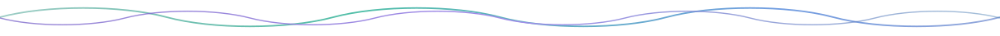
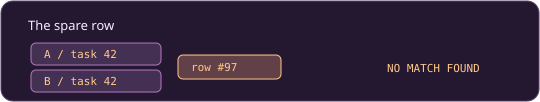

# harness-lab

Compare coding-agent runs from CSV and get JSON reports that show which runs counted, which tasks matched, and how much data was missing.

## Quick start

Requires Python 3.12+ and [uv](https://docs.astral.sh/uv/). From this repository:

```sh
uv run --locked harness-lab demo
```

The offline synthetic example checks hand-calculated counts, outcomes and paired comparisons. It demonstrates evaluator correctness, not model performance.

<picture>
  <source media="(prefers-color-scheme: dark)" srcset="assets/wave.svg">
  
</picture>

## How it works

<picture>
  <source media="(prefers-color-scheme: dark)" srcset="assets/workflow.svg">
  
</picture>

Comparisons match task and repeat. Ambiguous pairs are rejected. Missing counters stay missing, with a separate denominator per metric.

<details>
<summary>CSV format and reporting rules</summary>

```sh
uv run --locked harness-lab report --input runs.csv --json-out report.json
uv run --locked harness-lab compare --input runs.csv --left agent-a --right agent-b
```

The [example CSV](examples/synthetic_runs.csv) defines the 13-column input contract. `entry_id` is unique; `repeat` is a nonnegative campaign-local repetition label. Each task has one language. Missing token counters are blank, not zero. Invalid booleans, negative counters, non-finite timings and contradictory metadata fail validation.

| Question | Policy |
| --- | --- |
| Which rows enter metrics? | Completed runs: no network, infrastructure or timeout flag |
| Which outcomes count? | Recorded raw pass/fail; no adjusted success score |
| Which observations are compared? | Exact task/repeat pairs within the two selected variants |
| What if campaign labels collide? | Ambiguous cells with a counterpart are rejected |
| What if counters are missing? | Each metric reports its own paired denominator |
| How are p50/p95 calculated? | R type 7 linear interpolation |
| Is there a global winner? | No ranking across unequal workloads |

A ratio uses sums over the same available paired observations, with right-side zero denominators marked non-comparable. Timing includes completed failures: fast failure is not necessarily useful efficiency. Pair details and raw outcomes remain visible.

</details>

<picture>
  <source media="(prefers-color-scheme: dark)" srcset="assets/wave.svg">
  
</picture>

## Verification

The repository includes [synthetic observations](examples/synthetic_runs.csv) for a reproducible walkthrough of validation, exclusions, and matching by task and repeat.

```sh
uv run --locked harness-lab report --input examples/synthetic_runs.csv --json-out report.json
```

The demo and the report illustrate the evaluator's rules. The input is synthetic and does not measure model performance.

<details>
<summary>Development checks</summary>

The runtime uses the Python standard library. A strict CSV contract keeps the evaluator independent of any agent provider or serving stack. Quantiles follow the [R stats definition](https://stat.ethz.ch/R-manual/R-devel/library/stats/html/quantile.html), type 7. Sources reviewed 16 November 2026.

```sh
uv sync --locked --group dev
uv run --locked python -m unittest discover -s tests -t .
uv run --locked ruff check .
uv run --locked ruff format --check .
```

See [verification](docs/verification.md) for local results. CI is configured for Linux and Windows.

</details>

## Limits

This package evaluates recorded observations. It does not execute coding agents or provision models. A valid comparison still depends on matched tasks, comparable conditions, and the checks used to score each run.

Small paired samples, selection conditional on completion and reused campaign labels limit inference. Future public runs need licensed workloads, immutable revisions, a model/serving snapshot, budgets, independent test contracts and unique campaign identifiers.

<details>
<summary>The spare row · 97</summary>

<picture>
  <source media="(prefers-color-scheme: dark)" srcset="assets/side-quest.svg">
  
</picture>

</details>

## License

[Apache-2.0](LICENSE). The included CSV is synthetic.
